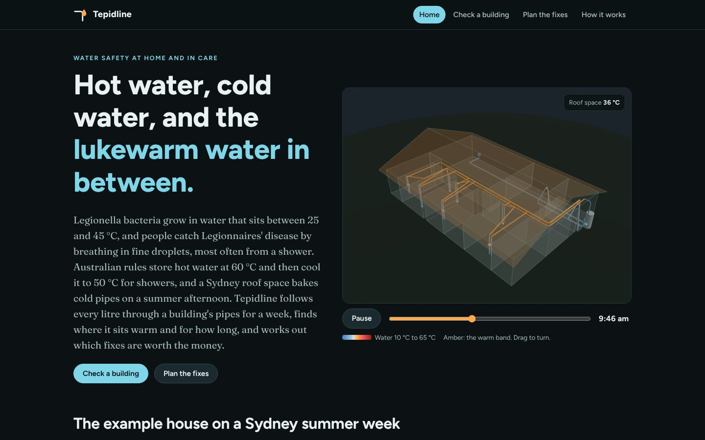
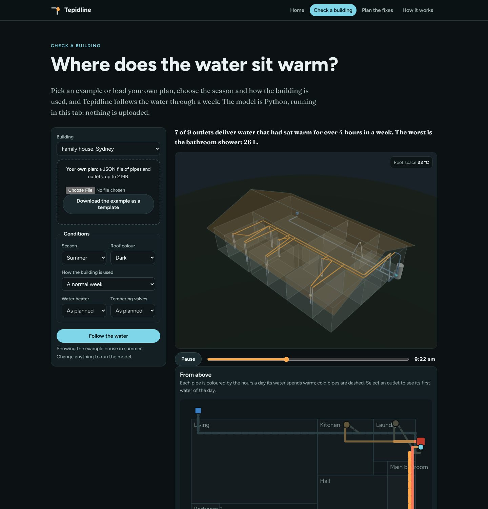
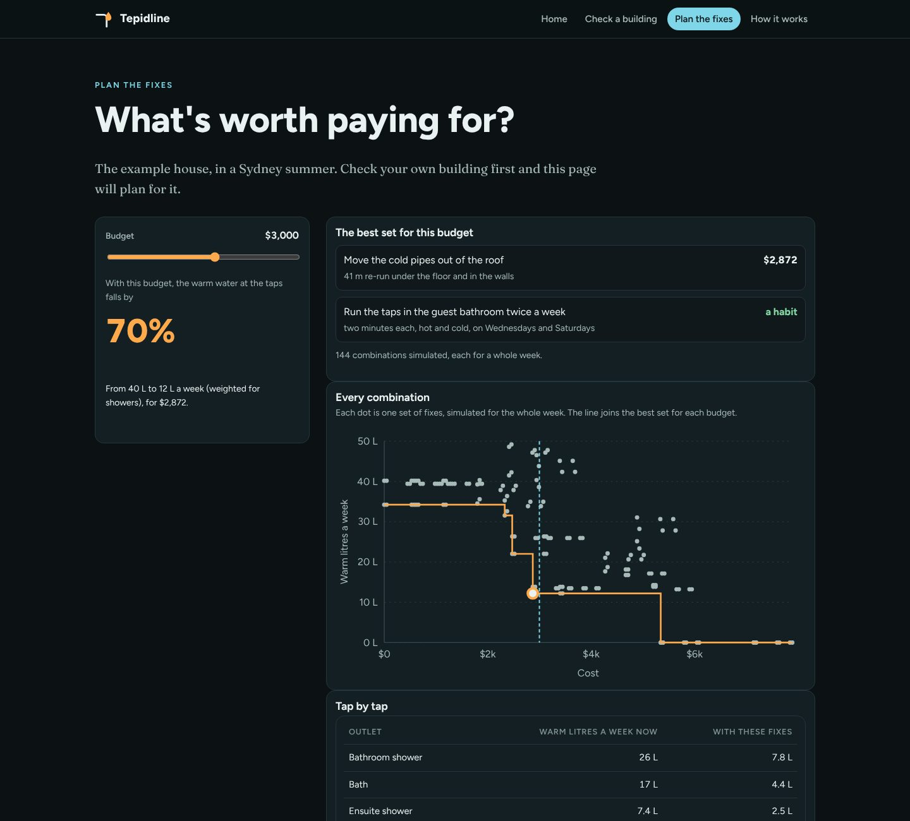
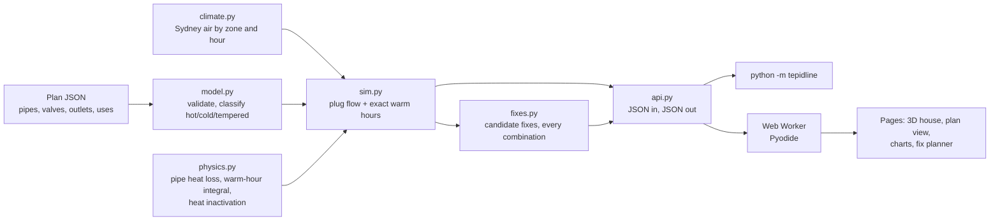

# Tepidline

**Find the water that sits lukewarm in a building's pipes, and the cheapest way to stop it.**

[](https://github.com/reihooneh/tepidline/actions/workflows/ci.yml)


**Live demo:** https://reihooneh.github.io/tepidline/



## Why I built this

Legionella bacteria grow in water between about 25 and 45 °C, and people catch Legionnaires'
disease by breathing fine droplets, most often in a shower. Australian plumbing rules store hot water
at 60 °C to keep it safe, then cool it to 50 °C (45 °C in aged care) with a tempering valve so nobody
is scalded. That trade-off creates long runs of pipe full of 50 °C water that cools into the danger
band between showers. Add a Sydney roof space that reaches nearly 50 °C on a summer afternoon, cold
pipes running through it, and a guest bathroom used once a week, and a perfectly ordinary house has
water sitting warm for hours.

Hospitals and aged-care homes manage this with water safety plans, sampling and flushing rosters.
What I couldn't find was a way to *see* it: to follow the water through a building's actual pipes,
day by day, and ask which change makes the most difference for the money. So I built one.

## What it does

- **Follows every litre for a week.** Plug flow through every pipe: when a tap runs, the water at
  the end comes out and everything upstream shifts along, fed by the heater, the mains, or a
  tempering valve mixing to its set temperature.
- **Counts warm hours exactly.** Standing water relaxes towards the air around its pipe (roof space,
  wall, under the floor) and the time each parcel spends in the warm band is integrated in closed
  form. Water that gets hot enough for long enough, at measured inactivation rates, counts as
  heat-treated.
- **Says which taps deliver it**: litres a week of water that sat warm for over 4 hours before it
  came out, the longest any of it sat, and the litres you run waiting for hot water.
- **Plans the fixes.** Lagging, moving pipes out of the roof, tempering at each bathroom, a hotter
  heater, flushing habits or valves for rarely used rooms: Tepidline simulates *every* allowed
  combination and shows the best set for any budget.
- **3D and from above.** A see-through house whose pipes change colour through the day, a plan view
  coloured by warm hours, and the first water of the day at any tap.
- **Your own building**: load a plan as JSON (the example downloads as a template). It never
  leaves your browser.

### What it found in the example house (a Sydney summer)

| | |
|---|---|
| Worst tap | the bathroom shower: 26 L a week of water that had sat warm for 4+ hours |
| Warmest pipe | the tempered run across the roof: 8.4 warm hours a day |
| Guest shower, used Saturdays | its first water had sat warm for 26 hours |
| Lagging the roof pipes | barely helps: a lagged pipe still reaches the roof's temperature within an hour |
| Best $2,872 | move the cold pipes out of the roof and run the guest taps twice a week: **−70 %** |
| In winter | most of the problem disappears |

In the aged-care wing, where one 45 °C valve feeds eight rooms along a ceiling, tempering at each
bathroom cuts warm water at the taps by 86 %.





## How it fits together



The same Python package runs natively (tests, the command line, and the build, which precomputes
the examples) and in the browser through Pyodide, so the page and the tests can never disagree; a
browser test checks the live run matches the build exactly.

## Stack

- **Python 3.12**, standard library only; `mypy --strict`, `ruff` (with security rules), `bandit`, `pytest`
- **Pyodide 0.29.4** to run that Python in a Web Worker, self-hosted
- **three.js 0.170.0** for the 3D house, hand-built SVG for the plan and charts, no framework
- **Playwright 1.63.0** for browser tests at phone, tablet and desktop widths

## Run it

```sh
python3 -m tepidline check house                 # the example house, summer
python3 -m tepidline check care --season winter  # the aged-care wing
python3 -m tepidline plan house                  # every combination of fixes
python3 -m tepidline example house > plan.json   # a template for your own building
python3 -m tepidline verify                      # the model's checks

npm ci
npm run build    # precomputes the examples, copies Pyodide and the package, builds the pages
npm run serve    # http://127.0.0.1:4173
```

## Tests

```sh
python3 -m pytest          # 36 tests: exact integrals, hostile plans, conservation, fixes
ruff check . && mypy tepidline && bandit -r tepidline
npm test                   # 19 browser tests, including Python running live in the page
```

The browser tests fail on overlapping text, overlapping controls, SVG text outside its chart,
sideways scrolling at three widths, console errors, a weakened CSP, or any request leaving the site.

## Security

A plan is untrusted input. It is parsed as JSON (never evaluated), checked field by field against
hard limits before anything runs, and simulated inside Pyodide's WebAssembly sandbox in a Web
Worker. Nothing from a plan reaches the page as markup. The CSP allows only the site's own scripts
(plus WebAssembly) and nothing external. Full threat model in [SECURITY.md](SECURITY.md).

Tepidline screens for conditions; it doesn't test water or predict infections.

## Roadmap

- Hot water recirculation loops and heat traced pipes
- Measured temperatures from a few sensors to calibrate each pipe's surroundings
- Climate zones beyond Sydney, and a floor-plan editor in the browser

## Learn more

[HOW-IT-WORKS.md](HOW-IT-WORKS.md) explains the model, the trade-offs, and the questions I'd expect
in an interview.

---

MIT licensed. Built by Reihaneh Rahmati.
